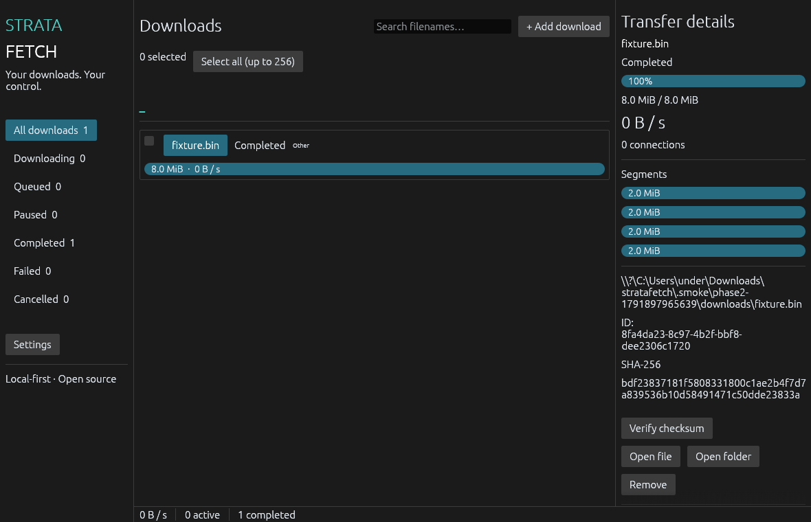

# StrataFetch

A native, local-first HTTP download manager built in Rust. MIT OR Apache-2.0.

**Experimental Windows alpha — stable release acceptance remains open.** No production readiness or performance advantage is claimed. There are no advertisements, telemetry, accounts, or cloud services.

Source: [Sub2Nex/stratafetch](https://github.com/Sub2Nex/stratafetch). [Published Windows alpha](https://github.com/Sub2Nex/stratafetch/releases/tag/v0.1.0-alpha.1). [Release gates and evidence](docs/PHASE2.md) describe the locally tested alpha and its remaining limits.



## Run

For a Windows portable preview, extract the ZIP and run `stratafetch-desktop.exe`. The command-line executable is `stratafetch.exe`. Rust is only needed when building from source.

Install stable Rust and the platform build tools. On Windows use Visual Studio Build Tools with the C++ workload. On Linux install `libxkbcommon-dev`, `libwayland-dev`, and standard C/C++ development tools.

```sh
cargo build --release --locked
cargo run --release --bin stratafetch-desktop
```

The desktop uses eframe 0.36.2 with wgpu. Paste a direct URL with Ctrl+V or open Add Download with Ctrl+N. You can paste several URLs, one per line. Set the destination in Settings or the Add dialog. Select a download to view segments, checksum, and transfer controls. Partial transfers remain paused after a restart. Completed files are never automatically executed. Native launch and rendering are verified; the full manual interaction checklist remains outstanding.

## CLI

```sh
stratafetch add https://example.org/file.zip --directory ./downloads
stratafetch --json list
stratafetch --require-service list
stratafetch status DOWNLOAD_ID
stratafetch pause DOWNLOAD_ID
stratafetch resume DOWNLOAD_ID
stratafetch cancel DOWNLOAD_ID
stratafetch restart DOWNLOAD_ID
stratafetch limit DOWNLOAD_ID 1048576
stratafetch settings --connections 4 --concurrent-jobs 3 --global-bytes-per-second 1048576 --organize-by-extension
stratafetch schedule DOWNLOAD_ID UNIX_UTC_TIME --category Work
stratafetch export history.json
stratafetch import history.json --directory ./downloads
stratafetch verify DOWNLOAD_ID EXPECTED_SHA256
stratafetch serve
```

With a desktop or `serve` instance running, commands use local IPC. Without one, the CLI opens the state directory exclusively and runs the transfer until completion or Ctrl+C. `--state PATH` isolates another instance. Removing a job deletes history and staging data, preserving completed files. Pause before changing a limit or removing a running job.

## Feature status

| Feature | Implementation |
|---|---|
| HTTP/HTTPS, redirects, TLS validation | Streaming reqwest/rustls |
| Byte-range transfers | Up to four connections by default; exact response bounds and validators checked |
| Fallback | Single stream when ranges or validators are unavailable |
| Pause/resume | Persisted segment checkpoints; safe resume requires matching remote validators and local prefix checksums |
| Recovery | Interrupted jobs become paused; durable bytes precede checkpoint writes |
| Integrity | SHA-256 partial-prefix and completed-file checksums; GUI/CLI can re-read completed files for verification |
| Concurrency | Three active jobs by default; queued jobs ordered by priority |
| Limits | Aggregate bandwidth through GUI/CLI; per-download GUI/CLI limits and priority; pause before changing job settings |
| Native desktop | Real progress, measured speed, speed graph, search, status filters, details, context menus |
| Preferences | Destination, light/dark theme, core English/Swedish labels, window geometry |
| Browser handoff | Experimental Chrome/Edge/Firefox extensions and Rust native host; manual registration |
| Scheduling/categories | Scheduled UTC starts while engine runs; categories, optional extension subfolders, priority/FIFO queues |
| Batch controls/history recipes | Select up to 256 jobs for pause/resume/cancel; bounded JSON exports/imports recreate paused recipes |
| Tray, notifications, clipboard monitoring, drag/drop | Planned |
| Authentication/custom headers | Planned; no embedded URL credentials accepted |
| HLS/DASH/DRM | Unsupported; direct MP4/WebM URLs work as ordinary files |

## Comparison scope

| Capability | StrataFetch preview | Established managers |
|---|---|---|
| Resume and bandwidth controls | Byte-validated HTTP resume and payload limits | FDM documents resume/traffic modes; JDownloader documents pause and bandwidth limits |
| Organization and scheduling | Extension folders and timed starts while running | IDM and FDM document broader category/scheduler options |
| Browser integration | Explicit handoff, experimental extensions | IDM documents mature browser integration and site exceptions |
| Archive extraction/torrents | Not implemented | JDownloader documents archive extraction; FDM documents BitTorrent |
| Public source | Entire Rust workspace, MIT OR Apache-2.0 | JDownloader describes open source; FDM labels open source specifically under legacy 3.9 features |

This compares documented scope, not independently tested speed, reliability, or security. Sources checked 2026-10-11: [IDM options](https://www.internetdownloadmanager.com/support/options.html), [FDM features](https://www.freedownloadmanager.org/features.htm), [JDownloader overview](https://jdownloader.org/download/index).

## Platforms and downloads

Windows x64 is the locally verified primary build target. Linux x64 and macOS remain unverified. All testing and packaging run locally; GitHub Actions is disabled. All binaries and the per-user NSIS installer are unsigned. No signing or notarization is claimed. Stable release acceptance remains open.

Download the unsigned [portable ZIP](https://github.com/Sub2Nex/stratafetch/releases/download/v0.1.0-alpha.1/stratafetch-windows-x64.zip), [experimental installer](https://github.com/Sub2Nex/stratafetch/releases/download/v0.1.0-alpha.1/stratafetch-windows-x64-setup.exe), and [SHA256SUMS](https://github.com/Sub2Nex/stratafetch/releases/download/v0.1.0-alpha.1/SHA256SUMS). The portable CLI/desktop passed actual execution checks. Windows application control blocked the final installer on the build machine, so its final install/uninstall roundtrip is unverified; an earlier preview passed. Installer source preserves download data. Browser integration is a separate opt-in step. [Packaging instructions](docs/INSTALLATION.md) reproduce the local build.

History exports contain URLs, including any query tokens. Keep them private. Imports do not restore checkpoints or completed status and never start transfers automatically. Schedules need a running desktop/service and reopen paused after shutdown. Engine settings persist in SQLite; existing partial files keep their segment layouts.

## Browser integration

See [browser installation](docs/BROWSER.md). The extension reads only a selected link or explicitly requested current-tab URL. It does not collect cookies or browsing history, intercept all downloads, or detect protected streams. Start the desktop or CLI service before sending a URL.

## Development

```sh
cargo fmt --all -- --check
cargo clippy --workspace --all-targets --locked -- -D warnings
cargo test --workspace --locked
cargo doc --workspace --no-deps --locked
```

Tests use local servers and do not depend on public downloads. [Architecture](ARCHITECTURE.md), [security](SECURITY.md), [privacy](PRIVACY.md), [contributing](CONTRIBUTING.md), and [roadmap](ROADMAP.md) describe the design and remaining work. The compact workspace separates the reusable engine from application clients, with networking and storage in separate modules.

## License

Licensed under either [MIT](LICENSE-MIT) or [Apache License 2.0](LICENSE-APACHE), at your option. Contributions use the same dual license.
